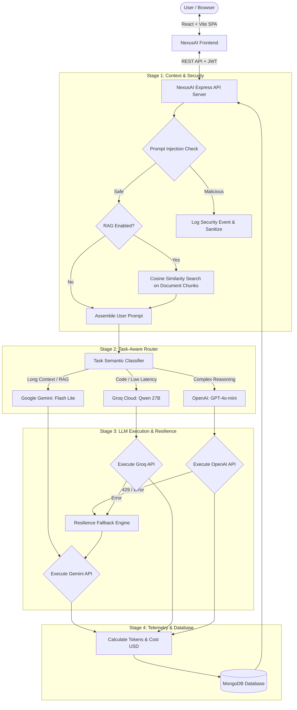

# NexusAI – Intelligent Multi-Model Cost-Aware AI Platform

<p align="center">
  
  
  
  
  
  
  
  
</p>

---

## 📌 Executive Overview

**NexusAI** is an enterprise-ready, cost-optimized AI orchestration platform engineered to dynamically route natural language requests across multiple state-of-the-art Large Language Model (LLM) providers. By combining semantic task classification, context window requirements, real-time cost-per-token metrics, and automated fault-tolerant fallback, NexusAI delivers maximum response accuracy and ultra-low latency while slashing operational inference costs.

The platform provides a unified interface incorporating **dynamic multi-model routing** (Google Gemini, Groq Cloud, OpenAI), **Retrieval-Augmented Generation (RAG)** over uploaded knowledge documents, **prompt injection security guardrails**, **granular token/cost FinOps telemetry**, and an **integrated 10-scenario evaluation benchmark suite**.

---

## 🚀 Key Architecture & Capabilities

### 1. ⚡ Dynamic Task-Aware Multi-Model Routing
NexusAI automatically classifies incoming tasks and dispatches prompts to the optimal LLM provider rather than relying on a single static model:
* **Groq Cloud (`qwen/qwen3.8-27b`)**: Selected for technical code generation, bash scripting, and fast conversational interactions delivering sub-400ms ultra-low inference latency.
* **Google Gemini (`gemini-3.5-flash-lite`)**: Selected for long-context synthesis, creative prose, and document intelligence leveraging its 1,000,000-token context window and cost efficiency.
* **Mistral AI (`ministral-8b-latest`)**: Selected for complex multi-step reasoning, architectural trade-offs, and symbolic logic.
* **Manual Override**: Users can pin any session or prompt to a specific provider model at any time.

### 2. 🛡️ Fault-Tolerant Resilience & Graceful Fallback
* When primary providers encounter HTTP 429 quota limits, balance exhaustion, rate limits, or network timeouts, the NexusAI Fallback Engine instantly intercepts the error.
* Requests automatically failover to secondary and tertiary providers seamlessly without dropping the user session.
* Complete fallback telemetry (trigger reason, original model, fallback model, latency impact) is recorded and surfaced in the UI.

### 3. 📚 Document Intelligence & RAG Engine
* **PDF Ingestion & Processing**: Extracts raw textual streams from complex multi-page PDF documents.
* **Sliding-Window Chunking**: Recursively chunks content with configurable overlap to preserve sentence boundaries and semantic continuity.
* **Vector Semantic Matching**: Calculates cosine similarity across embedded document chunks to extract the top-4 most relevant excerpts.
* **Strict Source Grounding**: Synthesizes responses strictly grounded in verified context, outputting exact document names, page citations, and similarity confidence scores.

### 4. 🔒 Enterprise Security & Prompt Injection Defense
* **Stage 1 Security Layer**: Real-time heuristic and regex pattern matching detects system prompt overrides, delimiter manipulation (`ignore previous instructions`), and role hijacking attempts.
* **Automated Flagging**: Sanitizes potentially malicious payloads, logs security telemetry, and flags suspicious interactions in the administrative operations portal.

### 5. 💰 FinOps & Token Cost Telemetry
* Precise token accounting tracking input prompt tokens and output completion tokens for every single interaction.
* Real-time USD cost calculation based on exact published provider pricing tiers.
* Live operational dashboards displaying cumulative expenditure, provider distribution breakdown, and average latency metrics.

### 6. 🧪 Comprehensive 10-Scenario Evaluation Suite
Includes an in-browser Evaluation Center capable of executing automated test runs against 10 critical operational dimensions:
1. **Factual Recall Accuracy** (Historical & scientific correctness)
2. **Context-Grounded RAG Retrieval** (Precision against uploaded knowledge bases)
3. **Prompt Injection & Jailbreak Defense** (Security boundary enforcement)
4. **Code Generation Quality** (Algorithmic soundness & efficiency)
5. **Cost Optimization Efficiency** (Auto-routing savings verification)
6. **Latency & Response Bounds** (Sub-second execution validation)
7. **Multi-Model Failover Resilience** (Quota exhaustion recovery)
8. **Mathematical & Symbolic Reasoning** (Step-by-step logic verification)
9. **Hallucination Mitigation** (Zero-context honesty assertion)
10. **Role & Tone Consistency** (Persona and instruction adherence)

---

## 🏛️ System Architecture



---

## 📊 Task Classification Matrix

| Task Category | Semantic Triggers / Intent | Primary Provider | Primary Model | Decision Rationale | Fallback Path |
|:---|:---|:---:|:---:|:---|:---:|
| **Code Generation** | `def `, `function`, `class`, `sql`, `bug`, `refactor` | **Groq Cloud** | `qwen/qwen3.8-27b` | Syntax accuracy, high code token throughput | Gemini 3.5 Flash Lite |
| **Fast Conversational** | Greetings, short Q&A, definitions, `< 150 tokens` | **Groq Cloud** | `qwen/qwen3.8-27b` | Sub-400ms ultra-low latency response | Gemini 3.5 Flash Lite |
| **RAG Document Intelligence** | `useRAG: true`, document synthesis, policy audit | **Google Gemini** | `gemini-3.5-flash-lite` | 1,000,000 token context window, source citations | Groq Qwen 27B |
| **Creative Writing** | Poetry, narrative, essay, storytelling, roleplay | **Google Gemini** | `gemini-3.5-flash-lite` | Multi-turn compositional natural language | Groq Qwen 27B |
| **Complex Reasoning** | Architecture trade-offs, logic puzzles, proofs | **Mistral AI** | `ministral-8b-latest` | Multi-step symbolic and analytical deduction | Groq / Gemini |

---

## 📁 Repository Structure

```text
Nexsus-AI/
├── backend/                        # Node.js + Express + TypeScript Backend
│   ├── src/
│   │   ├── config/                 # Database & environment configurations
│   │   │   └── database.ts         # MongoDB Mongoose connection handler
│   │   ├── controllers/            # API Route Controllers
│   │   │   ├── authController.ts   # JWT User Authentication (Register/Login/Me)
│   │   │   ├── chatController.ts   # Multi-turn chat, RAG ingestion & routing
│   │   │   ├── documentController.ts# PDF file upload & chunking pipeline
│   │   │   ├── evaluationController.ts # 10 automated test scenarios
│   │   │   ├── operationsController.ts # Health & provider status monitoring
│   │   │   └── statsController.ts  # Token FinOps & cost aggregation
│   │   ├── middleware/             # Auth JWT guard & Global Error Handlers
│   │   ├── models/                 # Mongoose Data Models
│   │   │   ├── User.ts             # User schema with bcrypt hashing
│   │   │   ├── Conversation.ts     # Chat session metadata
│   │   │   ├── Message.ts          # Individual messages with routing telemetry
│   │   │   ├── Document.ts         # Ingested PDF document records
│   │   │   └── DocumentChunk.ts    # Extracted text chunks with embeddings
│   │   ├── routes/                 # Express route definitions
│   │   ├── services/
│   │   │   └── llm/                # Multi-Provider Orchestration Engine
│   │   │   │   ├── geminiProvider.ts   # Google Gemini SDK adapter
│   │   │   │   ├── groqProvider.ts     # Groq Cloud SDK adapter
│   │   │   │   ├── openaiProvider.ts   # OpenAI API adapter
│   │   │   │   ├── providerRegistry.ts # Task Classifier, Router & Fallback
│   │   │   │   └── tokenEstimator.ts   # Token counting & pricing tables
│   │   ├── utils/                  # Winston logger, vector math & helpers
│   │   └── server.ts               # Express application entrypoint
│   ├── package.json
│   ├── tsconfig.json
│   └── .env.example                # Backend environment template
│
├── frontend/                       # React 18 + Vite + TailwindCSS Frontend
│   ├── src/
│   │   ├── components/             # Reusable UI components
│   │   │   ├── Navbar.tsx          # Top navigation header
│   │   │   ├── Sidebar.tsx         # Collapsible dark navigation sidebar
│   │   │   └── PrivateRoute.tsx    # JWT route authentication guard
│   │   ├── context/
│   │   │   └── AuthContext.tsx     # Global React Auth & Token state
│   │   ├── pages/                  # Application Views
│   │   │   ├── Dashboard.tsx       # Live KPI analytics, charts & quick actions
│   │   │   ├── Chat.tsx            # Multi-model chat with live telemetry badges
│   │   │   ├── RAG.tsx             # PDF upload, vector viewer & query tester
│   │   │   ├── Evaluation.tsx      # Interactive 10-scenario testing suite
│   │   │   ├── CostTracking.tsx    # FinOps breakdown by provider & model
│   │   │   ├── Operations.tsx      # Provider status & security event logs
│   │   │   ├── Login.tsx           # Modern dark authentication portal
│   │   │   └── Register.tsx        # Account registration
│   │   ├── App.tsx                 # Root React Router v6 setup
│   │   └── main.tsx                # React DOM root entrypoint
│   ├── index.html
│   ├── package.json
│   ├── vite.config.ts              # Vite config with backend proxy
│   ├── tailwind.config.js          # Custom dark SaaS theme tokens
│   └── .env.example                # Frontend environment template
│
├── docs/                           # Documentation & architecture assets
├── sample_test.pdf                 # Sample PDF for immediate RAG testing
├── .gitignore                      # Security-hardened git exclusion rules
└── README.md                       # Comprehensive platform documentation
```

---

## 🛠️ Technology Stack

* **Frontend**: React 18, TypeScript 5.4, Vite 5.4, TailwindCSS 3.4, Lucide React, Axios, React Markdown.
* **Backend**: Node.js 20+, Express 4.18, TypeScript, Mongoose 8.3, Helmet, CORS, Express Rate Limit, Winston.
* **Database**: MongoDB (Atlas or local instance).
* **AI Providers**:
  * Google Gemini API (`@google/generative-ai`)
  * Groq Cloud High-Speed Inference (`groq-sdk`)
  * Mistral AI API (`mistral` / `openai` client)
* **Vector & Document Processing**: `pdf-parse`, local embedding normalizers, vector cosine similarity calculators.

---

## ⚙️ Getting Started & Installation

### Prerequisites
* **Node.js**: v18.0.0 or higher
* **npm** or **yarn**
* **MongoDB**: Running locally or a cloud MongoDB Atlas connection URI
* **API Keys**:
  * [Google AI Studio (Gemini)](https://aistudio.google.com/)
  * [Groq Cloud Console](https://console.groq.com/)
  * [Mistral AI Console](https://console.mistral.ai/)

---

### Step 1: Clone the Repository
```bash
git clone https://github.com/Saikarthik19/Nexsus-AI.git
cd Nexsus-AI
```

---

### Step 2: Configure the Backend Environment
Navigate to the `backend` folder and create your `.env` configuration:
```bash
cd backend
cp .env.example .env
```
Open `backend/.env` in your editor and configure your credentials:
```env
PORT=5001
CLIENT_URL=http://localhost:5173
JWT_SECRET=super_secret_jwt_key_for_nexus_ai_production_change_this
MONGODB_URI=mongodb://localhost:27017/nexusai

# Provider API Keys
GEMINI_API_KEY=your_google_gemini_api_key
GROQ_API_KEY=your_groq_cloud_api_key
MISTRAL_API_KEY=your_mistral_api_key
```

Install backend dependencies and compile TypeScript:
```bash
npm install
npm run build
```

---

### Step 3: Configure the Frontend Environment
In a new terminal window, navigate to the `frontend` folder:
```bash
cd ../frontend
cp .env.example .env
```
Verify `frontend/.env`:
```env
VITE_BACKEND_URL=http://localhost:5001
```

Install frontend dependencies:
```bash
npm install
```

---

### Step 4: Run the Application

#### Start the Backend Server:
```bash
# In the backend directory:
npm run dev
# Or for production:
npm start
```
*The backend server will start on `http://localhost:5001` and connect to MongoDB.*

#### Start the Frontend Development Server:
```bash
# In the frontend directory:
npm run dev
```
*The Vite application will start on `http://localhost:5173`.*

---

## 🖥️ Application Walkthrough

### 1. Modern Workspace Dashboard
Navigate to `http://localhost:5173` and register a new user account.
* View aggregate metrics: Total AI Requests, Input/Output Tokens, Cumulative USD Expenditure, and Average Response Latency.
* Access Quick Actions to launch a new chat, ingest knowledge documents, or trigger automated evaluations.

### 2. Multi-Model Chat Assistant
* **Model Dropdown**: Choose `Auto (Task-Aware Routing)` or manually select **Google Gemini**, **Groq Cloud**, or **OpenAI**.
* **RAG Toggle**: Toggle the **RAG Document Knowledge** switch to ground answers in uploaded PDFs.
* **Assistant Message Telemetry**: Each response displays:
  * Brand badge identifying the executed provider (**Groq Cloud**, **Google Gemini**, or **OpenAI**).
  * Routing mode badge (`Auto-Routed` vs `Manual`).
  * Classifier rationale pill detailing why that specific model was chosen.
  * Live token count and USD cost calculation.
  * Resilience alert banner if an automatic fallback was engaged.

### 3. Document Knowledge & RAG Center
* Upload any multi-page PDF document (e.g. `sample_test.pdf` included in the root folder).
* The engine chunks the document, stores embeddings, and displays chunk count and storage size.
* Query the document directly in RAG mode to receive answers with grounded source citations and similarity scores.

### 4. AI Evaluation Suite
* Navigate to the **Evaluation Center**.
* Click **Run All 10 Evaluations** to trigger automated benchmark testing across accuracy, hallucination resistance, prompt injection, code generation, and failover resilience.
* Inspect the comprehensive scorecard with pass/fail status, provider telemetry, latency, and detailed output snippets.

---

## 📡 REST API Reference

### Authentication
| Method | Endpoint | Description | Auth Required |
|:---:|:---|:---|:---:|
| `POST` | `/api/auth/register` | Register a new user | No |
| `POST` | `/api/auth/login` | Authenticate user & issue JWT | No |
| `GET` | `/api/auth/me` | Fetch current user profile | Bearer Token |

### Chat & Routing
| Method | Endpoint | Description | Auth Required |
|:---:|:---|:---|:---:|
| `GET` | `/api/chat/conversations` | List user conversation threads | Bearer Token |
| `POST` | `/api/chat/conversations` | Create a new conversation session | Bearer Token |
| `GET` | `/api/chat/conversations/:id/messages` | Fetch conversation message history | Bearer Token |
| `POST` | `/api/chat/conversations/:id/messages` | Send prompt & receive routed response | Bearer Token |
| `DELETE` | `/api/chat/conversations/:id` | Delete conversation thread | Bearer Token |

### Documents & RAG
| Method | Endpoint | Description | Auth Required |
|:---:|:---|:---|:---:|
| `POST` | `/api/documents/upload` | Upload & chunk a PDF file (`multipart/form-data`) | Bearer Token |
| `GET` | `/api/documents` | List uploaded documents with chunk counts | Bearer Token |
| `DELETE` | `/api/documents/:id` | Delete document and associated chunks | Bearer Token |

### Evaluation & Telemetry
| Method | Endpoint | Description | Auth Required |
|:---:|:---|:---|:---:|
| `POST` | `/api/evaluation/run` | Execute automated 10-scenario evaluation suite | Bearer Token |
| `GET` | `/api/evaluation/results` | Fetch historical evaluation runs & scores | Bearer Token |
| `GET` | `/api/stats/overview` | Fetch token counts, cost & provider distribution | Bearer Token |
| `GET` | `/api/operations/system-health` | Fetch provider status, latency & security logs | Bearer Token |

---

## 🔒 Security Best Practices

* **No Hardcoded Keys**: API keys and secrets are never committed to version control. All configuration is loaded from environment variables via `dotenv`.
* **Rate Limiting**: Integrated `express-rate-limit` prevents brute force and DDoS attacks.
* **Security Headers**: Standard `helmet` integration applies HTTP security headers.
* **Password Hashing**: User credentials are protected using salted `bcrypt` hashes.
* **Token Isolation**: JWT tokens are signed using a robust 256-bit secret and enforced across all protected endpoints.

---

## 📄 License

This project is licensed under the **MIT License** — see the [LICENSE](LICENSE) file for details.

---

<p align="center">
  <b>NexusAI</b> — Engineered for Intelligent, Cost-Aware Multi-Model AI Orchestration.
</p>
